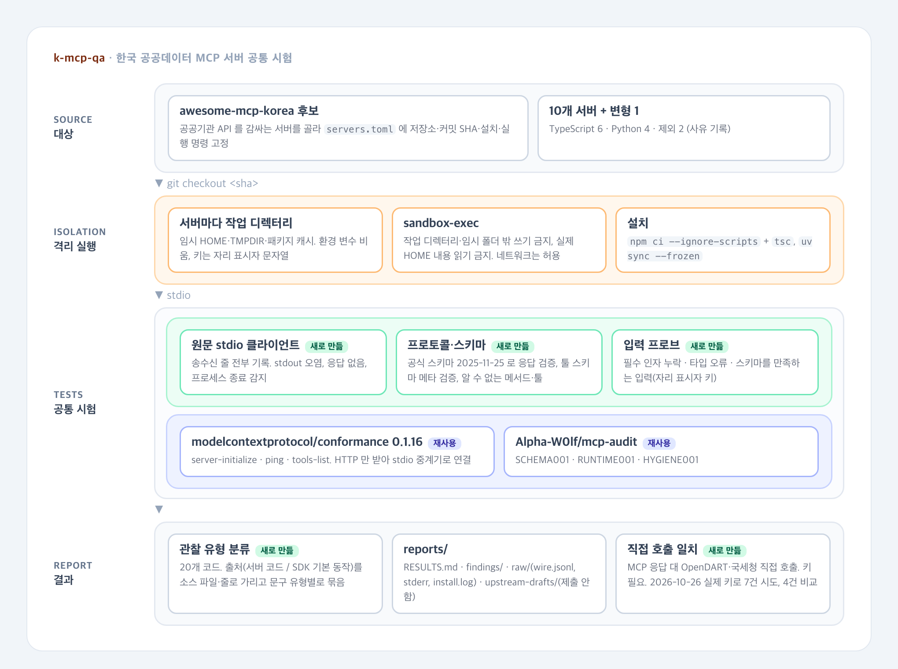

# 한국 공공데이터 MCP 서버 공통 시험

[](https://github.com/parksungyun0411/k-mcp-qa/actions/workflows/ci.yml)   [](LICENSE)

공공기관 API를 감싸는 한국 MCP 서버 10개를 커밋 SHA로 고정해 격리 환경에서 설치·실행하고, 같은 시험을 돌려 관찰한 동작을 유형별로 기록하는 프로젝트입니다.

시험 항목은 설치·기동, 프로토콜 적합성(initialize, tools/list, 응답 스키마, 알 수 없는 메서드·툴, 제한 시간), 선언된 입력 스키마와 실제 동작의 차이, 그리고 기관 API 오류를 어떻게 돌려주는가입니다. 공통 시험에는 실제 API 키를 쓰지 않았습니다. 키 변수에는 자리 표시자 문자열을 넣었기 때문에, 기관 API를 실제로 부르는 호출은 인증 오류를 받습니다. 이 상황에서 서버가 오류를 오류로 알려 주는지가 시험 항목 중 하나입니다.

MCP 서버의 응답과 기관 API를 직접 호출한 결과가 같은지 보는 검사도 했습니다. 이 검사만 2026-10-26에 실제 키로 따로 돌렸습니다. 값을 돌려준 서버 2개는 비교한 4건 모두 직접 호출로 받은 값이 MCP 응답에 들어 있었습니다. 나머지 1개는 이 프로젝트의 설치 조건 때문에 호출 자체가 실패해 비교하지 못했습니다.

결과는 2026-10-03 하루(직접 호출 일치 검사만 2026-10-26), 고정한 커밋에서 관찰한 동작입니다. 서버의 품질 순위가 아닙니다.

## 구현 범위

- 시험 대상 목록 `servers.toml`: 저장소, 커밋 SHA, 라이선스, 설치 명령, 실행 명령, 키 변수. 후보 검토 과정은 `reports/inventory.md`
- 격리 실행: 서버마다 임시 HOME·TMPDIR·패키지 캐시, 환경 변수 비움, macOS `sandbox-exec` 로 작업 디렉터리와 시스템 임시 폴더 밖 쓰기, 실제 HOME 내용 읽기(uv 파이썬·node 설치 경로 제외) 차단, npm 라이프사이클 스크립트 미실행
- stdio JSON-RPC 클라이언트: SDK를 거치지 않고 송수신 줄을 그대로 기록(`reports/raw/<서버>/probe/wire.jsonl`)
- 프로토콜·스키마 검사: MCP 공식 스키마(2025-11-25)로 응답 검증, 툴 inputSchema/outputSchema 메타스키마 검증
- 입력 프로브: 툴마다 필수 인자 누락, 타입 오류, 스키마를 만족하는 입력 세 가지로 호출하고 응답 형태와 프로세스 생존을 기록
- 기존 도구 연동: 공식 `modelcontextprotocol/conformance`(stdio→HTTP 중계기 경유), `Alpha-W0lf/mcp-audit`
- 관찰 유형 분류 20종, 관찰마다 입력·응답·재현 명령과 출처(서버 코드 / SDK 기본 동작, 소스 파일·줄). 재현 도구 `uv run python -m kmcpqa.repro`
- 이슈 초안 생성(`reports/upstream-drafts/`). 업스트림 저장소에 올리지 않았습니다
- 직접 호출 일치 검사: MCP 응답 대 OpenDART·국세청 직접 호출. 직접 호출 클라이언트는 [vendor-check-agent](https://github.com/parksungyun0411/vendor-check-agent) `a9dc8d4` 에서 import 경로만 바꿔 가져왔습니다

### 재사용한 것과 새로 만든 것

| 구분 | 내용 |
|---|---|
| 재사용 | [modelcontextprotocol/conformance](https://github.com/modelcontextprotocol/conformance) 0.1.16 의 서버 시나리오 `server-initialize`, `ping`, `tools-list` |
| 재사용 | [Alpha-W0lf/mcp-audit](https://github.com/Alpha-W0lf/mcp-audit) `b14487f` 의 `SCHEMA001`, `RUNTIME001`, `HYGIENE001` |
| 재사용 | MCP 공식 JSON 스키마 `schema/2025-11-25/schema.json` (modelcontextprotocol/modelcontextprotocol `75db1e9`) |
| 새로 만듦 | 한국 공공데이터 서버 시험 행렬(고정 SHA, 설치·실행 절차, 격리 환경), 원문 stdio 클라이언트, 입력 프로브, 관찰 유형 분류, 직접 호출 일치 검사, 보고서·재현 도구 |

비슷한 작업으로 [sallim-app/korea-mcp-index](https://github.com/sallim-app/korea-mcp-index)가 있습니다. 원격 주소가 있는 한국 데이터 MCP 서버에 질문을 보내 응답 가능 여부와 답의 사실 오류를 잽니다. 이 프로젝트는 설치형 stdio 서버를 고정 커밋에서 직접 띄워 프로토콜·스키마·오류 처리를 보고, 답의 정확성은 기관 API 직접 호출과 비교하는 쪽으로 둡니다.

## 아키텍처



원본은 `docs/diagrams/architecture.html` 입니다.

| 단계 | 파일 | 하는 일 |
|---|---|---|
| 받기·설치 | `src/kmcpqa/sandbox.py` | `git checkout <sha>`, 설치 명령을 샌드박스 안에서 실행 |
| 공통 시험 | `src/kmcpqa/probe.py`, `wire.py`, `specschema.py`, `synth.py` | 키 없이 시작, 자리 표시자 키로 시작, 프로토콜 요청, 툴별 입력 프로브 |
| 기존 도구 | `src/kmcpqa/external.py`, `bridge.py` | conformance(HTTP 중계), mcp-audit |
| 분류 | `src/kmcpqa/defects.py` | 결과 JSON 에서 관찰 유형을 뽑음 |
| 보고 | `src/kmcpqa/report.py`, `repro.py` | `reports/RESULTS.md`, `findings/`, `upstream-drafts/`, 재현 |
| 일치 검사 | `src/kmcpqa/agreement.py`, `direct/` | MCP 응답 대 기관 API 직접 호출 (키 필요) |

## 기술 스택

| 영역 | 기술 |
|---|---|
| 언어 |  |
| 프로토콜 검증 |    |
| 격리 |    |
| HTTP |    |
| 코드 품질·CI |    |

## 실행 방법

### 준비

macOS, Python 3.12, [uv](https://docs.astral.sh/uv/), Node.js(npm), git 이 필요합니다. `dart-mcp-server` 는 Python 3.10 을 요구하므로 `uv python install 3.10` 을 먼저 실행합니다. 샌드박스 안에서는 `UV_PYTHON_DOWNLOADS=never` 로 인터프리터 다운로드를 막습니다.

```bash
uv sync --extra dev
make test lint        # 픽스처 서버(합성)로 시험 코드 자체를 검증
```

### 실측

```bash
make probe            # 받기·설치·키 없는 공통 시험 → reports/results/, reports/raw/ (커밋된 결과를 덮어씀)
make external         # 공식 conformance, mcp-audit → reports/raw/<서버>/external/
make report           # reports/RESULTS.md, findings/, upstream-drafts/
```

작업 디렉터리는 기본값 `/tmp/kmcp-work` 입니다(`WORKDIR=` 로 변경). 관찰 하나를 다시 보려면:

```bash
uv run python -m kmcpqa.repro dart-mcp-server kmcpqa/unknown_method '{}'
uv run python -m kmcpqa.repro korean-dart-mcp tools/call '{"name": "get_company", "arguments": {}}'
```

`reports/findings/` 에서 재현 명령이 `kmcpqa.runner --only <서버>` 인 관찰은 그 서버의 공통 시험을 다시 돌리며, `reports/results/` 의 해당 결과 파일과 `_run.json` 을 덮어씁니다.

### 직접 호출 일치 검사 (키 필요)

```bash
cp .env.example .env   # DATA_GO_KR_SERVICE_KEY, OPENDART_API_KEY
make probe             # 대상 서버를 받아 설치. 공통 시험도 다시 돌려 reports/results/·raw/ 를 덮어쓴다
make agreement         # 설치된 서버를 띄우고 .env 를 읽어 → reports/agreement/<서버>.json, _run.json
```

이 검사는 입력한 키를 시험 대상 서버의 환경 변수로 넘깁니다. 남의 코드에 키를 넘기는 것이므로 실행 여부는 직접 판단해야 합니다. 비교 사례는 `servers.toml` 의 `[[server.agreement]]` 에 있습니다(OpenDART 기업개황 3건 × 서버 2개, 국세청 상태조회 1건).

## 평가

직접 호출 일치 표를 제외한 모든 수치는 2026-10-03 실행(`reports/results/_run.json`), 요청 프로토콜 버전 2025-11-25, 키 없음(자리 표시자) 조건입니다. 원본은 `reports/RESULTS.md`, `reports/summary.json`, `reports/raw/` 입니다.

시험 대상과 기동(`reports/RESULTS.md` 서버별 요약):

| 항목 | 값 | 출처 |
|---|---:|---|
| 시험한 서버 | 10 (+ 의존성 하나를 고정한 변형 1) | `servers.toml` |
| 제외한 서버 | 2 | `reports/RESULTS.md` 시험하지 않은 서버 |
| 설치 명령 성공 | 11 / 11 | `reports/results/*.json` 의 `install.ok` |
| 자리 표시자 키로 initialize 응답 | 10 / 11 | 서버별 요약의 initialize 열 |
| 공식 conformance 세 시나리오 통과 | 9 / 9 (측정한 실행) | 서버별 요약의 공식 conformance 열 |
| 공식 conformance 측정 불가 | 1 | korean-dart-mcp. 시나리오 중 서버 프로세스가 이미 종료(I3)¹ |

¹ 이 실행의 conformance 응답은 서버가 아니라 k-mcp-qa 중계기가 만든 것입니다(`k-mcp-qa bridge: server process not running`, `reports/raw/korean-dart-mcp/external/conformance/`). 서버의 conformance 실패로 세지 않았습니다.

관찰은 출처별로 나눴습니다. 응답 문구와 stderr 스택을 고정 커밋의 서버 소스와 설치된 SDK 소스에서 찾아, 서버 소스에서 확인되면 **서버 코드**, SDK 소스에서만 확인되면 **SDK 기본 동작(확인)** 으로 분류하고 소스 파일·줄을 함께 적었습니다(`src/kmcpqa/attribution.py`). SDK 기본 동작은 서버에 대한 관찰로 세지 않습니다.

관찰 유형 분류 20종 가운데 서버 코드에서 관찰된 것은 아래 9종(I2·I3·P4·S4·R3·E1·E2·E3·H1)입니다. SDK 기본 동작으로 확인된 P3·P6 까지 더하면 11종이지만, 이 둘은 서버에 대한 관찰로 세지 않습니다.

서버 코드에서 나온 관찰(`reports/RESULTS.md` 서버 코드에서 나온 관찰). 해당 실행 수와 문구 유형 수/발생 수입니다. 문구 유형은 같은 코드·출처·문구(입력 값·숫자 제거)를 하나로 묶은 단위라 근본 원인 수가 아닙니다. 같은 소스 줄에서 나온 응답도 입력 종류나 응답 모양에 따라 여러 유형으로 나뉩니다. 예를 들어 dart-mcp-server 의 E3 문구 유형 12개는 모두 `dart/mcp_factory.py:117` 에서 나왔습니다(`reports/findings/dart-mcp-server.md`).

| 코드 | 내용 | 해당 실행 | 문구 유형/발생 합계 |
|---|---|---:|---:|
| I2 | initialize 응답 없음 | 1 | 1/1 |
| I3 | 시작 후 5초 안에 종료 | 1 | 1/1 |
| P4 | 알 수 없는 툴에 isError 결과로 응답 | 2 | 2/2 |
| S4 | properties 가 빈 inputSchema 인데 런타임은 인자를 요구 | 1 | 1/1 |
| R3 | 스키마를 만족하는 입력을 스키마에 없는 인자 조건으로 거부 | 2 | 3/3 |
| E1 | 실행 실패를 isError 없는 결과로 응답 | 5 | 15/121 |
| E2 | 기관 API 실패를 JSON-RPC -32603 으로 응답 | 1 | 1/44 |
| E3 | 입력 검증·파싱 오류를 isError 없는 결과로 응답 | 2 | 13/177 |
| H1 | 응답 본문에 Python traceback 과 파일 경로 | 1 | 1/87 |

발생 수는 툴 수에 비례해 늘어납니다. 툴이 89개인 서버의 발생 수(351)와 3개인 서버의 발생 수(3)를 그대로 비교할 수 없어, `reports/RESULTS.md` 에는 문구 유형 수와 툴당 발생 수를 함께 적었습니다.

SDK 기본 동작으로 확인된 관찰(서버에 대한 관찰이 아님, `reports/RESULTS.md` 같은 이름의 절):

| 코드 | 내용 | 해당 실행 | SDK 소스 위치 |
|---|---|---:|---|
| P4 | 알 수 없는 툴에 isError 결과로 응답 | 7 | TypeScript SDK `dist/esm/server/mcp.js` (1.29·1.30: 104행, 1.32: 144행), Python `mcp/server/fastmcp/tools/tool_manager.py`, `fastmcp/server/server.py` |
| P3 | 알 수 없는 메서드에 -32602 응답 | 3 | Python `mcp/shared/session.py` ("Invalid request parameters") |
| P3·P6 | 알 수 없는 메서드를 받은 뒤 응답 없음 | 1 | mcp 1.6.0 `mcp/shared/session.py:307` `_receive_loop` 의 처리되지 않은 ValidationError |

근거로 든 스펙 문장은 `reports/RESULTS.md` 에 원문 그대로 옮겼습니다. MCP 2025-11-25 Tools › Error Handling 절(https://modelcontextprotocol.io/specification/2025-11-25/server/tools#error-handling)은 "Unknown tools"·"Server errors" 를 Protocol Errors 의 예로, "API failures"·"Input validation errors"·"Business logic errors" 를 `isError: true` Tool Execution Errors 의 예로 듭니다. 이 절에는 MUST/SHOULD 같은 규범 키워드가 없습니다. P4·E1·E2·E3 은 이 서술과 다른 동작을 기록한 것이며 스펙 위반 판정이 아닙니다.

기존 도구 결과는 `reports/RESULTS.md` 의 공식 conformance·mcp-audit 열에 도구의 판정을 그대로 옮겼습니다. 키가 없으면 mcp-audit 의 `RUNTIME001`·`HYGIENE001` 은 기준 호출이 실패하는 툴에서 skip 됩니다(서버별 skip 수는 같은 열). 이 프로젝트의 입력 프로브(필수 인자 누락·타입 오류)는 기준 호출 성공을 전제하지 않아 이 조건에서도 결과가 나옵니다.

직접 호출 일치(`reports/agreement/`, 2026-10-26, 실제 키, 위와 같은 고정 커밋):

| 서버 | 사례 수 | 일치 | 불일치 | MCP 호출 실패 |
|---|---:|---:|---:|---:|
| korean-dart-mcp | 3 | 0 | 0 | 3 |
| dart-mcp-server | 3 | 3 | 0 | 0 |
| data-go-nts-business-verification-mcp1 | 1 | 1 | 0 | 0 |

- 판정은 필드 경로를 맞추지 않고, 직접 호출로 받은 필드 값(공백·하이픈 제거)이 MCP 응답 본문(structuredContent 또는 text)에 들어 있는지로 합니다(`src/kmcpqa/agreement.py`). 서버마다 응답 형식이 달라서입니다. 표의 "일치"는 비교한 필드 값이 모두 응답에 들어 있었다는 뜻입니다.
- dart-mcp-server 는 삼성전자 등 3개 회사의 기업개황에서 법인명·법인등록번호·사업자등록번호 값이 모두 응답에 들어 있었습니다. 국세청 서버는 상태(계속사업자)가 응답에 들어 있었습니다. 이 서버의 상태 값은 기관 API 응답의 `b_stt` 를 그대로 옮긴 것입니다(고정 커밋의 `data_go_mcp/nts_business_verification/server.py:166`). 사업자번호도 판정 필드였지만 조회에 넣은 값이라 판정에 정보가 없습니다. 이 서버는 기관 API 가 401 을 돌려줄 때도 입력한 번호를 응답에 넣습니다(`reports/findings/data-go-nts-business-verification-mcp1.md` 의 E1).
- korean-dart-mcp 의 실패 3건은 서버의 결함으로 보지 않습니다. 이 서버는 SQLite 네이티브 모듈(better-sqlite3)을 쓰는데, 이 프로젝트는 남의 패키지 스크립트를 실행하지 않으려고 `npm ci --ignore-scripts` 로 설치합니다. 그래서 모듈의 바이너리가 받아지지 않았고, 툴 호출이 `Could not locate the bindings file` 오류로 끝났습니다(결과 파일의 `error`). 설치 스크립트를 허용한 조건에서는 다시 재지 않았습니다.
- 10-26 결과 파일에는 비교한 건의 MCP 응답 원문과 실행 시각·시험 커밋이 남아 있지 않습니다. 위 날짜는 결과를 올린 커밋(`ec44052`) 기준이고, 시험 커밋은 `servers.toml` 의 고정값으로 적었습니다. 지금 코드는 비교한 건에 응답 발췌(키 제거)를, `reports/agreement/_run.json` 에 실행 시각·시험 커밋·SDK 버전을 남깁니다.
- 사례가 7건뿐이라 정확도를 말할 수 있는 규모는 아닙니다. 서버가 직접 호출과 다른 값을 주는 경우가 있는지 보는 점검입니다.

일치 검사 코드는 합성 데이터의 가짜 업스트림과 픽스처 서버로 시험합니다(`tests/test_agreement.py`). 이 시험의 결과는 동작 확인용 단언이며 위 표에 넣지 않습니다.

## 프로젝트 구조

```text
k-mcp-qa/
├── servers.toml             시험 대상: 저장소, 커밋 SHA, 설치·실행 명령, 키 변수, 일치 검사 사례
├── src/kmcpqa/
│   ├── sandbox.py           작업 디렉터리, 환경 변수, sandbox-exec 프로파일
│   ├── wire.py              원문 stdio JSON-RPC 클라이언트
│   ├── probe.py             공통 시험
│   ├── synth.py             스키마에서 시험 입력 생성
│   ├── specschema.py        MCP 공식 스키마 검증 (spec/ 에 원본 사본)
│   ├── defects.py           관찰 유형 분류
│   ├── bridge.py            conformance 용 stdio→HTTP 중계기
│   ├── external.py          conformance, mcp-audit 실행
│   ├── agreement.py         직접 호출 일치 검사
│   ├── direct/              기관 API 클라이언트 (vendor-check-agent 에서 복사)
│   └── runner.py · report.py · repro.py
├── tests/                   픽스처 서버(합성)로 시험 코드 검증
├── reports/
│   ├── RESULTS.md           서버별 요약과 관찰 유형별 건수
│   ├── inventory.md         후보 목록과 선정·제외 사유
│   ├── findings/            서버별 관찰과 재현 명령
│   ├── upstream-drafts/     이슈 초안 (제출하지 않음)
│   ├── agreement/           직접 호출 일치 결과
│   ├── results/             결과 JSON
│   └── raw/                 송수신 기록, stderr, 설치 로그, 외부 도구 원본 출력
└── docs/diagrams/           아키텍처 다이어그램 (HTML 원본과 PNG)
```

## 구현하면서 신경 쓴 점

- 남의 코드를 실행하기 전에 각 저장소의 설치 스크립트와 진입점을 읽었습니다. npm 은 `--ignore-scripts` 로 설치해 라이프사이클 스크립트를 막고 빌드는 `tsc` 를 직접 불렀습니다. 기본 실행 외의 동작(`setup` 하위 명령의 클라이언트 설정 파일 쓰기, 홈 디렉터리 캐시)은 기본 경로에서 실행되지 않거나 임시 HOME 안에서만 일어납니다.
- 공통 시험(2026-10-03)에서는 이 머신의 토큰과 키를 어떤 서버에도 넘기지 않았습니다. 환경 변수를 비우고 필요한 값만 넣었고, 키 변수에는 `KMCPQA_PLACEHOLDER_NOT_A_REAL_KEY` 를 넣었습니다. mcp-audit 은 서버에 SDK 기본 환경만 넘기므로 `env -i` 로 같은 환경을 다시 감쌌습니다. 2026-10-26 직접 호출 일치 검사만 실제 키(OpenDART·공공데이터포털)를 대상 서버 3개에 넘겼습니다.
- SDK 클라이언트 대신 원문 stdio 클라이언트를 썼습니다. SDK 는 잘못된 메시지를 걸러 내거나 예외로 바꾸기 때문에 서버가 실제로 보낸 내용을 남기기 어렵습니다. 공식 conformance 용 중계기도 같은 이유로 서버가 쓴 줄을 다시 직렬화하지 않고 그대로 돌려줍니다.
- 관찰은 "무엇을 보냈고 무엇이 돌아왔는가"로만 적고, 각 관찰에 재현 명령을 붙였습니다. 응답 문구와 stderr 스택을 서버 소스와 SDK 소스에서 찾아 출처를 가렸고, SDK 기본 동작으로 확인된 관찰은 서버 관찰 집계와 이슈 초안에서 뺐습니다. 같은 문구가 여러 툴에서 나오면 문구 유형 하나로 묶었습니다. 근본 원인을 추적해 묶은 것은 아닙니다.
- 요청 하나를 보낸 뒤 서버가 살아 있고 ping 에 응답하는지 확인합니다. 응답하지 않으면 그 요청에 관찰을 붙이고 새 프로세스로 바꿔, 한 번의 종료가 뒤 요청의 관찰로 번지지 않게 했습니다.
- conformance 용 중계기는 서버가 실제로 보낸 응답과, 서버 프로세스가 없어서 중계기가 대신 만든 응답(오류 코드 -32099)을 구분해 기록합니다.
- 원본 서버가 기동하지 않을 때는 그 결과를 그대로 두고, 의존성 하나만 고정한 변형을 별도 항목으로 시험했습니다. 변형은 표에 `(변형: mcp<2 고정)` 으로 표시합니다.
- 보고서 파일에 섞여 들어온 이 머신의 홈 경로는 `~` 로 바꿨습니다. 서버 traceback 과 실행 명령에 들어 있던 경로입니다.

## 한계

- 표본은 awesome-mcp-korea 에서 고른 10개(+변형 1)입니다. 라이선스가 없는 저장소는 우선 제외했고 원격 전용 서버는 다루지 않았습니다. 한국 공공데이터 MCP 서버 전체를 대표하지 않습니다.
- 실행은 2026-10-03 하루, 서버마다 고정한 커밋 하나입니다. 이후 커밋에서는 동작이 다를 수 있습니다. korean-dart-mcp 는 처음 고정한 커밋 `9631564` 가 같은 날 원격 저장소에서 조회되지 않아 그날의 HEAD `4b2e072` 로 다시 시험했습니다.
- 공통 시험은 키 없는 조건만 측정했습니다. 정상 키로는 직접 호출 일치 검사만 돌렸고(7건 시도, 4건 비교), 정상 키에서의 응답 형식은 재지 않았습니다. E1·E2·I3 은 유효하지 않은 키에서의 동작이며 정상 키에서는 나타나지 않을 수 있습니다.
- korean-dart-mcp 의 고정 커밋 `4b2e072` 는 10-26 기준 원격 저장소의 어떤 브랜치에도 없습니다(이후 히스토리가 바뀜). 일반 clone 으로는 받아지지 않아, 받기 단계에서 커밋 번호로 직접 받도록 고쳤습니다.
- 시험한 MCP 스펙 버전은 2025-11-25 입니다. 클라이언트가 이 버전을 요청했고 일부 서버는 2024-11-05·2025-03-26 으로 협상했습니다. 2026-07-28(무상태) 개정은 시험하지 않았습니다.
- 공식 conformance 는 특정 참조 서버의 툴을 전제하지 않는 세 시나리오만 돌렸습니다. 중계기는 단일 요청·JSON 응답만 지원합니다.
- 입력 프로브는 스키마에서 기계적으로 만든 값을 씁니다. 툴 의미에 맞는 값이 아니어서, R3 처럼 인자 조건으로 거부된 경우가 결함인지 의도된 제약인지는 판단하지 않았습니다.
- 오류처럼 보이는 응답의 판별(E1·E3)은 응답 본문의 문구로 합니다. 보고서의 근거 문장을 직접 확인해야 합니다.
- 출처 판별은 응답 문구·스택 프레임을 소스에서 문자열로 찾는 방식입니다. 문구가 기관 API 응답을 그대로 옮긴 경우 등은 위치를 찾지 못해 "소스 위치 미확인"으로 남습니다. 찾은 위치도 문구가 같은 줄일 뿐 실행 경로를 추적한 것은 아닙니다.
- 격리는 macOS `sandbox-exec` 에 의존합니다. 네트워크는 막지 않았고, 시스템 임시 폴더(`/private/var/folders`) 쓰기와 실제 HOME 의 파일 이름·메타데이터 조회는 허용됩니다(내용 읽기는 uv 파이썬 설치 경로와 node 설치 경로만 허용합니다. nvm 처럼 node 가 HOME 아래에 있으면 이 예외가 있어야 설치됩니다). CI(리눅스)에서는 실측을 돌리지 않고 시험 코드만 검증합니다.
- 출처 판별은 `make report` 가 서버 소스를 받아 둔 작업 디렉터리(기본 `/tmp/kmcp-work`)를 다시 읽어서 합니다. 그 디렉터리가 없으면 출처가 모두 "미확인"으로 나오므로, 커밋된 출처 판정은 실측 직후 같은 머신에서 만든 결과입니다.
- 관찰 건수는 툴 수에 비례합니다. 툴이 89개인 서버와 3개인 서버의 건수를 직접 비교할 수 없습니다.
- 이슈 초안은 사람이 검토하기 전의 자동 생성 문서이며 업스트림에 올리지 않았습니다.

## 라이선스

MIT. `src/kmcpqa/spec/schema-2025-11-25.json` 은 MCP 프로젝트 스키마의 사본이며 원 저장소의 라이선스를 따릅니다.
